# 让桌宠接入 QQ

> 接上之后，她就不只是桌面上那个会动的同桌了 —— 你可以直接在 QQ 里给她发消息、下达命令，她也能替你盯着群。
>
> 15 个步骤 · 全程图文对照 · Windows

## 目录

- [开始之前](#开始之前)
- [1 · 安装 NapCatQQ](#1--安装-napcatqq)
  - [下载并安装](#下载并安装-napcatqq-desktop)
  - [装上 SnowLuma 和 Node.js](#在组件管理里装上-snowluma-和-nodejs)
- [2 · 建 Bot，连上 QQ](#2--建-bot连上-qq)
  - [新建 Bot](#新建-bot填入-qq-号)
  - [添加正向 / 反向连接](#把正向反向两条连接都添加上)
  - [设置正向服务器](#设置正向服务器--顺便把-token-存下来)
  - [设置反向客户端](#设置反向客户端--主要是填对地址)
  - [保存设置](#保存整个-bot-的设置)
  - [启动 Bot](#启动-bot)
  - [登录并验证](#登录-qq然后验证一下)
- [3 · 在桌宠里接入](#3--在桌宠里接入-qq)
  - [安装 QQ Final 扩展](#安装-qq-final-扩展)
  - [确认装好了](#确认装好了)
  - [重启进程加载扩展](#重启进程让扩展加载)
  - [配置连接（默认反向）](#配置连接默认反向不用填-token)
  - [设置监听名单](#设置监听名单)
  - [修改提示词](#修改提示词-建议做)
- [检查清单](#检查清单)
- [常见问题](#常见问题)

---

## 开始之前

先说清楚整件事是怎么连起来的，后面的每一步就不会变成「照着点但不知道在干嘛」。

> **桌宠本身已经能聊天了** —— 前提是你在它的「开始」设置里接好了 AI 模型。如果这一步还没做，先去把模型配好，再回来看这篇。

要让桌宠收发 QQ 消息，中间得有个「中间人」：NapCatQQ。它负责登录一个 QQ 号、收发消息，再把消息转交给桌宠。所以你其实是在装两个东西：

- **NapCatQQ**：替你挂着一个 QQ，负责跟 QQ 服务器打交道。
- **桌宠的 QQ 扩展**：负责跟 NapCatQQ 对接，把消息变成桌宠能理解的话。

整篇教程需要你能正常访问 GitHub（下载 NapCatQQ 和 Node.js 都要从这里拿）。下面每一步都配了截图，照着点就行。

> **💡 为什么非要多一个 NapCatQQ？**
> QQ 并没有开放「让别的程序直接读消息」的接口。NapCatQQ 这类工具补上了这一层，所以它并不只是给桌宠用的 —— 任何支持 OneBot 协议的软件，都能借它收发 QQ 消息。

---

## 1 · 安装 NapCatQQ

这一步只做两件事：把 NapCatQQ 装上，把它的两个组件备齐。

### 下载并安装 NapCatQQ-Desktop

打开项目的 GitHub 页面，下载安装包并完成安装：

<https://github.com/NapNeko/NapCatQQ-Desktop>

GitHub 页面里有完整的使用指南。下面只讲 Windows 上最关键的那几步。

> **🌐 下载这一步需要能正常访问 GitHub 的网络环境**，打不开的话先把网络准备好再来。

### 在「组件管理」里装上 SnowLuma 和 Node.js

打开 NapCatQQ-Desktop，进入左侧的「组件管理」：

- 在「协议端」分组里找到 SnowLuma，点安装。
- 再到页面底部下载安装 Node.js。
- 如果你的电脑上已经装过 Node.js，那就只需要装 SnowLuma。

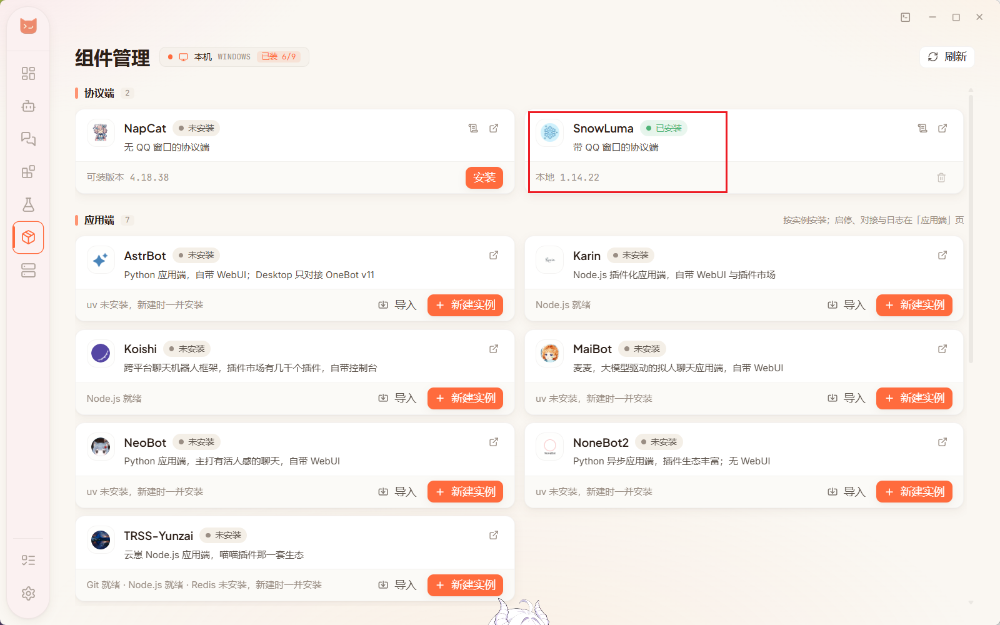

> **🧩 SnowLuma 和 NapCat 是同一件事的两种做法**，作用完全一样：架一层协议，能收发 QQ 消息，也能把消息转给桌宠这样的下游程序。
>
> 区别只在于 —— SnowLuma 需要电脑上开着 QQ 客户端，NapCat 不需要。这篇教程走的是 SnowLuma 这条路。

---

## 2 · 建 Bot，把 QQ 连上

接下来在 NapCatQQ 里建一个「Bot」—— 你可以把它理解成「一个被托管的 QQ 账号」。

### 新建 Bot，填入 QQ 号

进入「Bot 管理」，新建一个 Bot，填上你要用来接入的 QQ 号。

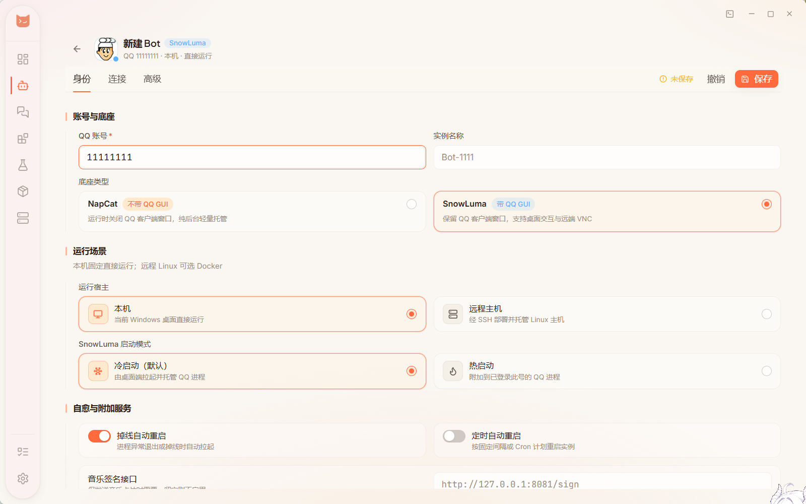

> 使用大号、小号都可以。新注册的账号可能容易被 QQ 风控，使用注册较久的 QQ 号不容易被风控。
>
> 如果你想用自己的 QQ 和桌宠的 QQ 聊天，那就需要给桌宠用另一个 QQ 号。

### 把正向、反向两条连接都添加上

进入这个 Bot 的「连接」页面，底部有一排添加按钮，这里既有正向也有反向：

- **「+ WS 正向服务器」**：NapCat 开个口子，等桌宠来连。
- **「+ WS 反向客户端」**：NapCat 主动去连桌宠侧的服务。

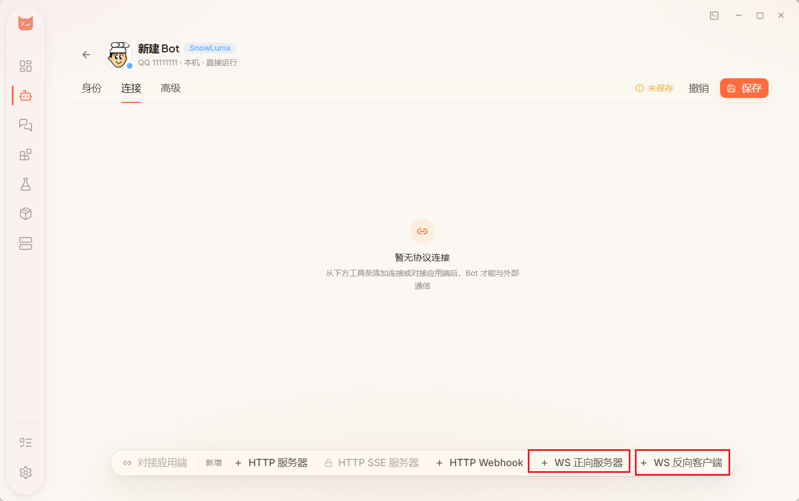

两条都要添加、都要设置。顺序无所谓，下面按正向 → 反向来讲。

### 设置正向服务器 —— 顺便把 Token 存下来

点「+ WS 正向服务器」，弹出的编辑窗里，监听 IP、端口这些用默认值就好。

唯一要动手的是底部的鉴权 Token：把它复制下来存到别处备用，后面在桌宠里要填的就是这一串。

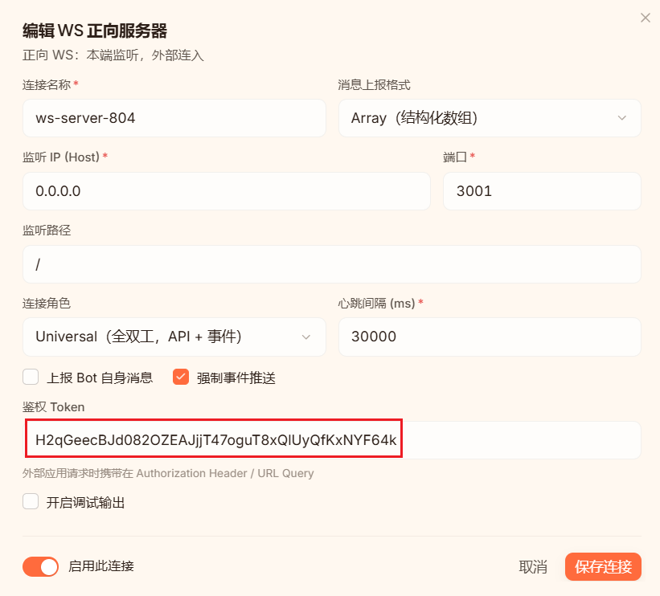

确认「启用此连接」是打开的，然后点右下角的「保存连接」。

> **🔌 这里的端口默认是 3001**，而桌宠默认就连 `ws://127.0.0.1:3001` —— 两边正好对得上，所以一般不用改。

### 设置反向客户端 —— 主要是填对地址

再点「+ WS 反向客户端」。这里最容易卡住的地方是：

- 服务端 WebSocket URL 的输入框是空的（虽然它下面给了默认地址的提示），需要你手动粘贴进去 ——
  `ws://127.0.0.1:8080/onebot/v11`
- 其余项保持默认，然后同样点右下角的「保存连接」。

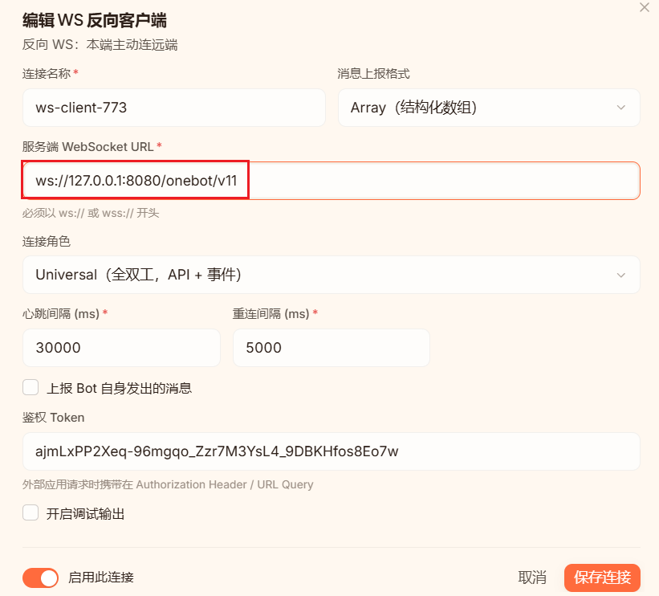

> **🔑 这个弹窗里也有一个 Token，但它不是桌宠要填的那个** —— 桌宠填的是上一步正向服务器里的 Token，别拿混了。

### 保存整个 Bot 的设置

正向、反向都设置好之后，点页面右上角的「保存」。看到「未保存」的提示消失，就说明存上了。

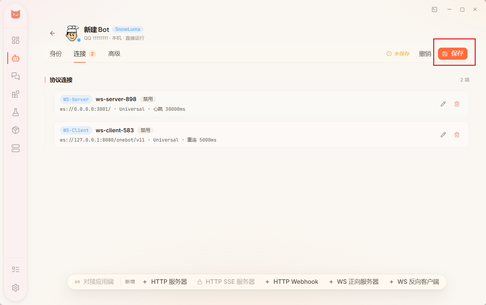

> **💾 这里有两个「保存」，别搞混**：弹窗里的「保存连接」只保存那一条连接，右上角的「保存」才是把整个 Bot 的设置存下来。两步都要点。

### 启动 Bot

回到 Bot 列表，点击这个 Bot 的「启动」。

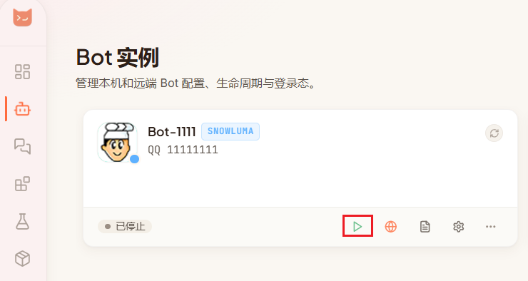

### 登录 QQ，然后验证一下

启动后会弹出 QQ 的登录界面，登录你在这个 Bot 里填的那个账号即可。

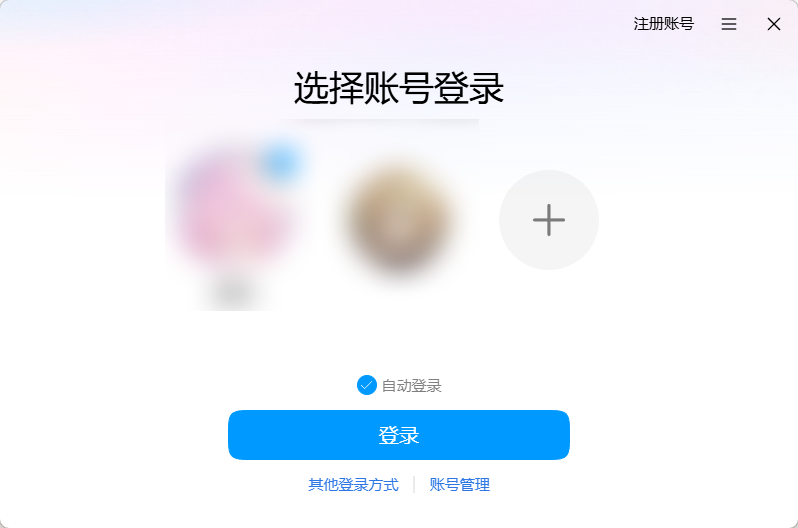

登录之后先测一下协议层通不通：用这个 QQ 给朋友或群里发条消息（也可以让别人给它发），然后点 NapCatQQ 左侧的聊天窗口，看看消息有没有出现在列表里。

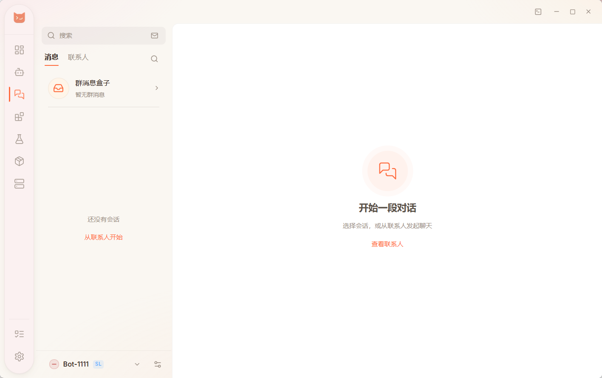

> **💡 这里的消息列表经常会有延迟**，设成免打扰的群也可能压根不显示。别慌 —— 那只是显示的问题，实际接收和转发是没有延迟的。

---

## 3 · 在桌宠里接入 QQ

协议层已经在跑了，现在把桌宠接上去。这一章装的是 **QQ Final 扩展**，全部设置都在桌宠里完成。

> **🔌 先说默认：QQ Final 默认走反向连接** —— 桌宠开监听、NapCat 主动连进来。所以「**OneBot Token 默认留空**」就行，只有你把连接模式改成「正向」时才需要填 Token。

### 安装 QQ Final 扩展

- 点左下角打开「高级模式」。
- 进入「扩展」页面，在「扩展市场」的搜索框里输入 `qq-final`。
- 找到 `cortico-world-qq-final` 卡片点安装（旁边的 `-final-beta` 是尝鲜版，功能更新但可能不够稳，按需选）。

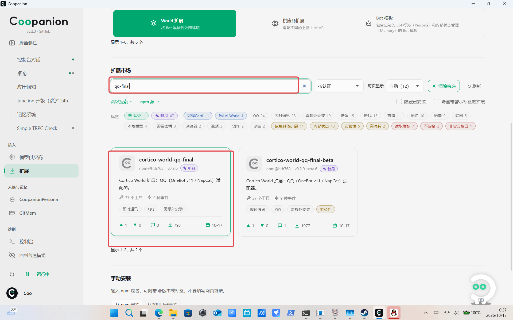

### 确认装好了

回到「已安装」列表，能看到 `cortico-world-qq-final` 卡片。右下角显示「待重启」是正常的 —— 扩展要等进程重启后才真正加载。

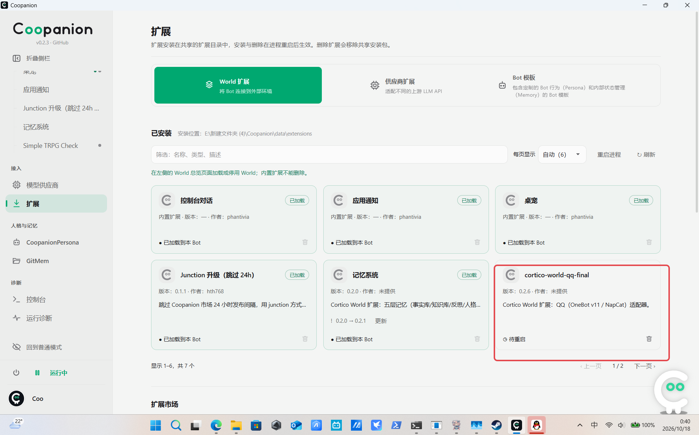

### 重启进程，让扩展加载

在「扩展」页面点右上角的「重启进程」（或直接完全退出桌宠再打开）。

> **⚠️ 这里必须是完整重启**，不能用控制台里那个进程内重启 —— 扩展是启动时加载的，进程内重启不会重新加载它。

重启后到「World 总览」，能看到 **QQ 群聊** 这张卡片，说明扩展已经加载成功。

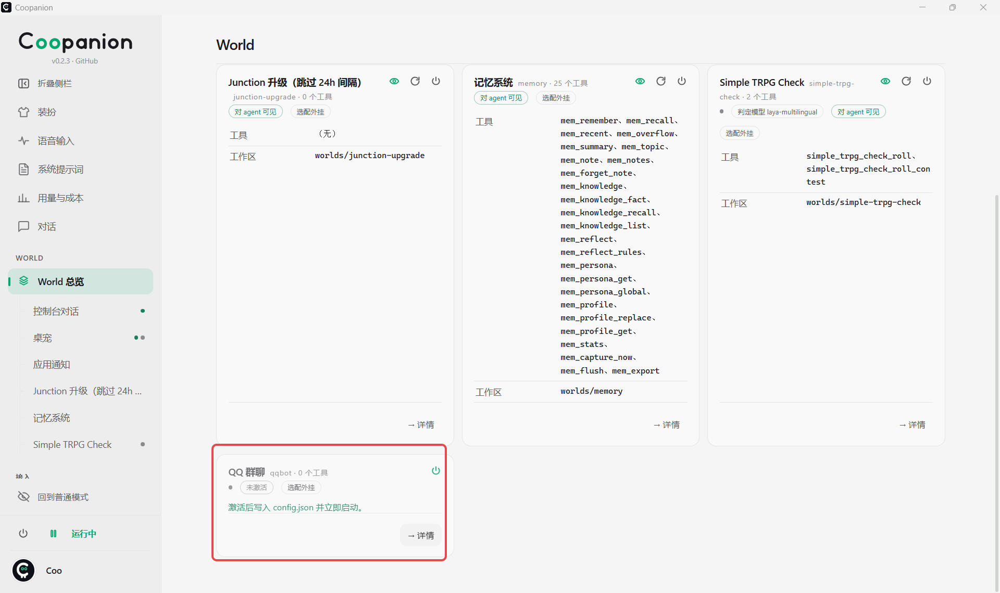

### 配置连接（默认反向，不用填 Token）

点左侧「QQ 群聊」进入面板，默认停在「连接与监听」这一页。按下图红框核对三处：

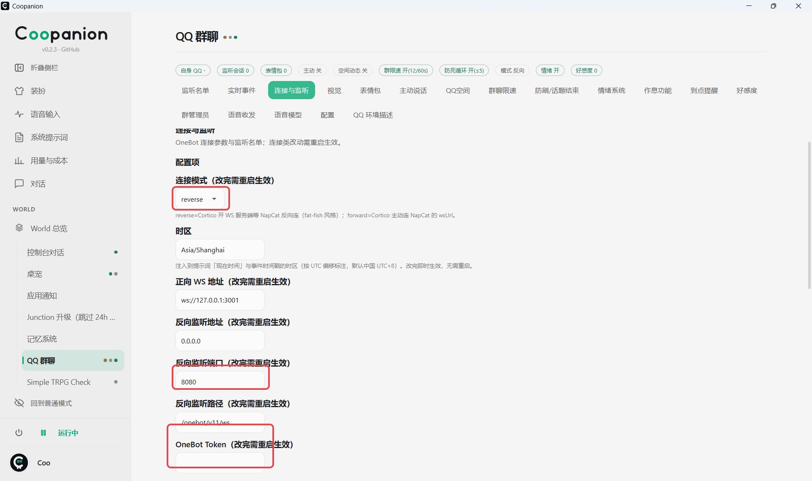

- **连接模式**保持 `reverse`（反向），这是默认值，不用改。
- **反向监听端口**要和 NapCat 里「设置反向客户端」填的端口一致（默认 `8080`）；**反向监听路径**默认 `/onebot/v11/ws`，也要和 NapCat 一致。
- **OneBot Token**：反向连接**留空**。只有切成 `forward`（正向）时，才填 NapCat「设置正向服务器」里那个 Token。

> **💡 改完连接参数后**，点面板右上角的「**重启连接**」就能立刻生效，**不用重启整个桌宠**。

### 设置监听名单

桌宠默认**不监听任何群聊或私聊**。想让她管哪些会话，就把群号、私聊的 QQ 号填进「监听群」和「监听私聊」—— 用空格或逗号分隔。

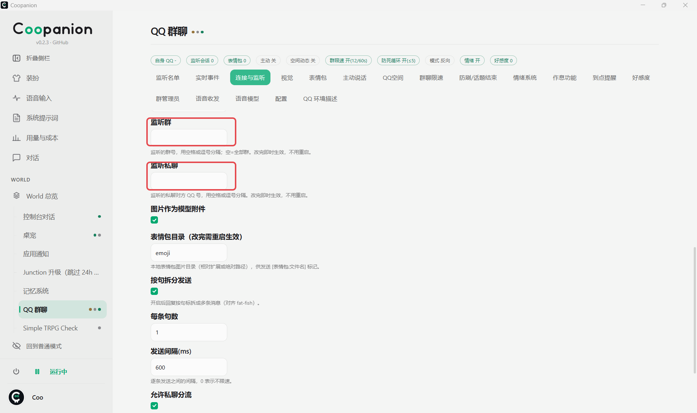

> **✅ 改完点一下别处**（输入框失去焦点）就自动保存，会提示「已保存 ✓ 即时生效」，不用再点按钮。**想取消监听就把框清空** —— 清空后读回来是空的，不会出现多余的号码。

填完就可以试了：**给桌宠的 QQ 发一条私聊**，她应该会回复你。如果监听了群消息，她可能也会自动回群里的消息。

### 修改提示词 建议做

提示词决定了她「看到消息之后怎么想、怎么回」。在「QQ 环境描述」面板里按自己的习惯改一改，比如告诉桌宠：

- 默认不需要识图；
- 不必每条消息都回，只在被叫到的时候回；
- 不要执行危险命令；
- 监控到特定关键词或场景时，执行某个动作。

改完记得保存。提示词不会立刻生效，回到「World 总览」点右上角的「**重载系统前缀**」，或者干脆**重启进程**。

> **🎉 到这儿就全通了。** 给她发条消息试试吧 —— 她会用自己的语气回你的。

---

## 检查清单

不通的时候回头对一遍，八成能一眼看出卡在哪。

- [ ] NapCatQQ 装好了，SnowLuma（或 NapCat）和 Node.js 都安装完成
- [ ] Bot 建好了，并且已经「启动」、登录了要接入的 QQ
- [ ] 正向服务器和反向客户端都配置好、各自点了「保存连接」
- [ ] 两条连接都配完后，点了页面右上角的「保存」
- [ ] 正向服务器的鉴权 Token 已经复制存好
- [ ] 反向客户端的地址填的是 `ws://127.0.0.1:8080/onebot/v11`
- [ ] 桌宠里 QQ 扩展已安装，并在 World 总览里启用了
- [ ] 监听名单里填了要管理的群号 / QQ 号
- [ ] 提示词改完后点过「重载系统前缀」（或重启了桌宠）

> ※ 如果换号、重装 NapCatQQ，Token 会重新生成，需要回到第 12 步重填一次。

---

## 常见问题

几个最容易踩的坑，先对照看看。

### 桌宠里一直显示「未连接」怎么办？

按这个顺序查：

- NapCatQQ 里的 Bot 是不是还在运行、QQ 是不是还登着？
- 正向服务器有没有打开「启用此连接」、有没有点过「保存连接」，最后有没有点右上角的「保存」？
- Token 用的是正向服务器那个吗？完整复制了吗？前后多一个空格都会连不上。
- 桌宠里的 WS 地址和 NapCat 里的端口是否一致（默认 3001）。

### 连接显示成功，但收不到消息 / 她不回话？

十有八九是监听名单是空的。桌宠默认不监听任何会话，必须把群号或私聊 QQ 号填进去。

另外：如果只是 NapCatQQ 的聊天窗口看不到消息，那是显示延迟，不影响实际收发。

### 正向和反向两个都要设置吗？

按教程都设置上最省事。它们只是「谁主动连谁」的方向不同：

- **正向 WS 服务器**：NapCat 开门等别人来连。桌宠连的就是这里（默认 3001 端口），Token 也从这里拿。
- **反向 WS 客户端**：NapCat 主动去连别人（教程里配的是 8080）。

两个都开着，以后换别的下游程序也能直接用。

### 两个「保存」按钮有什么区别？

弹窗里的是「保存连接」，只保存当前这一条连接的配置；页面右上角的是「保存」，保存整个 Bot 的全部设置。

所以顺序是：先给每条连接点「保存连接」，全部配完再点一次右上角的「保存」。

### 改了提示词，桌宠的表现完全没变？

提示词改完需要「重载系统前缀」才会生效。在 World 总览右上角，或者干脆重启一次桌宠。

### Token 弄丢 / 想换一个怎么办？

回到 NapCatQQ 里那个 Bot 的「连接」页面，打开正向 WS 服务器的配置，重新生成或复制 Token，再到桌宠里重填、保存并重启。

---

共 15 步 · 截图来自原教程